# ERPNext Implementation for a 30-Person Furniture Factory

**Path to ₹40 L/month:** an end-to-end ERPNext v16 implementation for a furniture manufacturer, modeled on a
real family business in Chennai. It covers discovery, fit-gap, configuration, data migration with reconciliation,
upgrade-safe customisations, a month of operations run as real ERP documents, and owner reporting.

> Processes, cost structure and pain points come from requirement interviews with the owner's family.
> All names, prices and quantities are synthetic. Every master value lives in one Excel template,
> so going live means swapping in real values, not changing code.

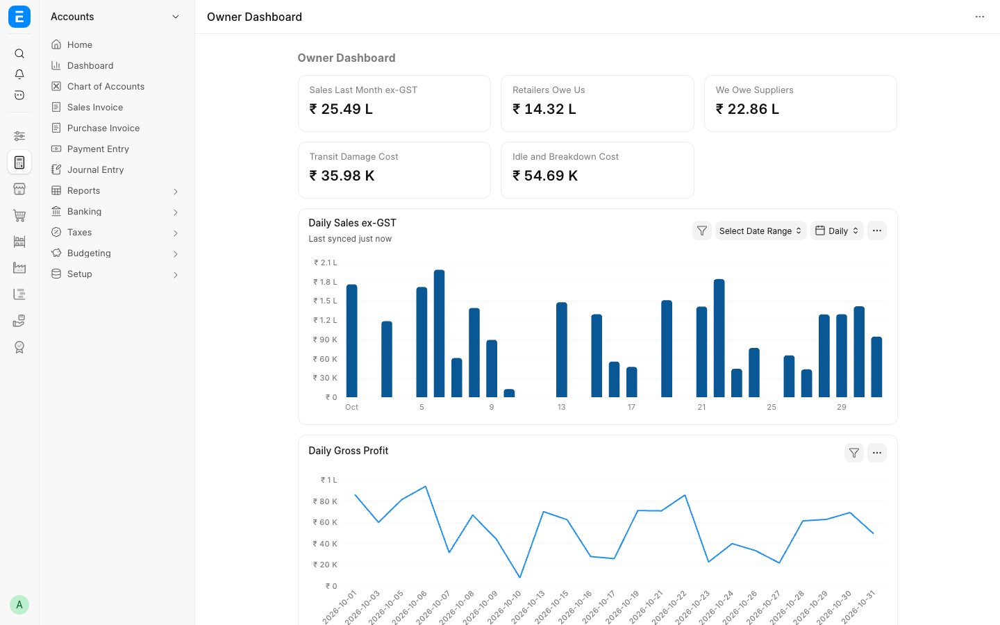

## The problem

The owner prices at cost + 80–90% and believes that's his margin. The books tell a different story:

<!-- RESULTS:START -->
| From the ERPNext books, October 2026 | |
|---|---|
| Turnover incl. GST | ₹3,007,861 (72 orders, 210 units) |
| Markup on making cost | 96% |
| **Net profit** | **₹651,161: 25.5% of net sales** |
| Fixed cost absorbed by production hours | 23% of ₹700,000 |
| Measured leaks (idle days, breakdown, damage, discounts, shrinkage, emergency buys) | ₹125,536 |

Full analysis and the levers for ₹40 L/month: [docs/06-results-october.md](docs/06-results-october.md).
<!-- RESULTS:END -->

Discovery found nine pain points ([docs/01](docs/01-discovery-and-problem-statement.md)): no daily profit view,
sheet stockouts caused by cash-tied reordering, disputes on custom walk-in wardrobes ("this is not what I asked"),
quality escapes and full-replacement transit damage, missing hardware, no supervisor, an untested
make-or-buy decision on a new cold press, breakdowns, and unmeasured offcut recovery.

## What was implemented

| Area | Implementation |
|---|---|
| **Costing model** | 9 workstations whose hourly rates come from the real fixed-cost structure (₹4 L salaries ÷ 6,240 h, power and rent by machine share). 16 multi-operation BOMs with expected offcut scrap |
| **Procure-to-pay** | PO → receipt → bill → payment; IGST for Gujarat, CGST+SGST for local; Landed Cost Vouchers put ₹8,000 lorry freight into sheet cost; **owner approval workflow for POs above ₹1 L** |
| **Planning (MRP)** | Reorder points computed from actual consumption (main board: 159 sheets, not the guessed 60); Production Plan over the open order book nets BOM requirements against stock and raises material requests. **Re-running October with the new policy: zero stockout days, ~₹50,000/month recovered, no extra freight** |
| **Order-to-cash** | Per-retailer pricing rules; 14-day terms with early-payment discount; **mandatory 6-point pre-dispatch quality inspection** |
| **Custom orders** | 13 custom fields (measurements, finish, layout, drawing, versioned spec, **customer signature**) + a server script that **blocks confirmation of any unsigned or incomplete custom order** |
| **Controls** | Custom DocTypes *Transit Damage Log* and *Production Downtime*; monthly hardware count posting shrinkage |
| **Make-or-buy** | Two active BOMs for the 3-door wardrobe (bought UV board vs board pressed in-house), compared on actual production cost |
| **Scrap recovery** | Offcuts valued into a Scrap Yard and consumed by frame, clock and scooter BOMs |
| **Owner reporting** | 4 SQL query reports (*Daily Sales and Profit*, *Product Profitability*, *Margin Leaks*, *Make or Buy*), 5 number cards, 2 charts, an Owner Dashboard workspace |
| **Roles** | Factory Owner / Accountant / Store and Floor / Retail Floor Sales role profiles |
| **REST integration** | Retail order intake service (FastAPI): floor staff send orders from a phone → validated → confirmed Sales Order via the ERPNext REST API; outbox + idempotency keys + retry with backoff → **exactly-once even through outages** (8/8 integration tests) |
| **Alerts** | In-app notifications: every confirmed order alerts the owner, accountant and store (with who sent it from the retailer floor); POs awaiting approval alert only the owner |
| **UAT** | 18 user-acceptance test cases executed against the site with evidence: **18/18 PASS** |
| **Migration** | Messy legacy Excel → cleansing, mapping and validation → opening stock and dues; every rejected row logged with a reason; **SQL reconciliation PASS on stock, receivables, payables and the opening account** |

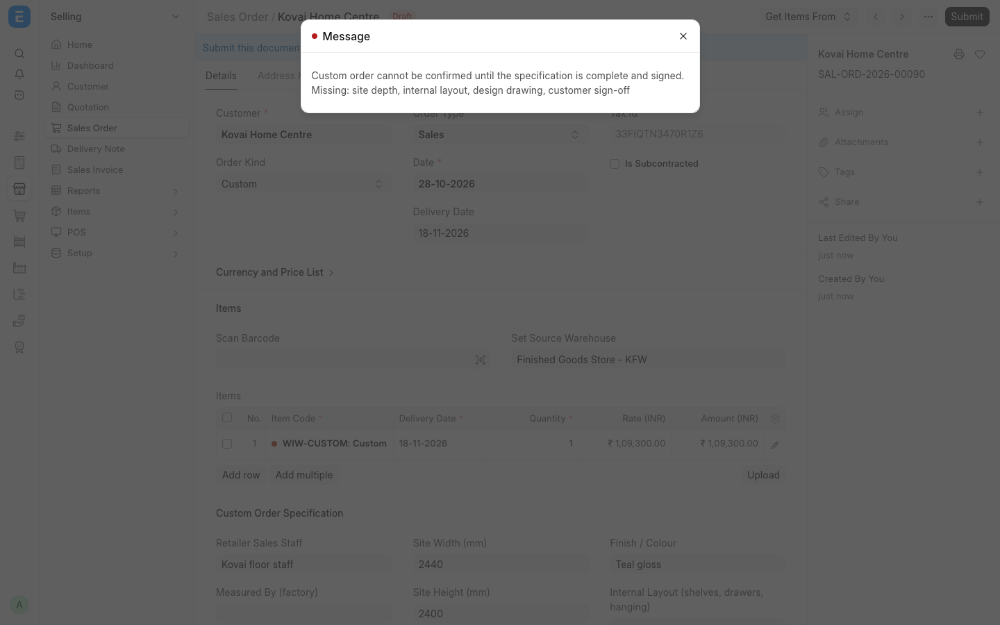
*The sign-off gate refusing an incomplete custom order: the fix for the "this is not what I asked" dispute loop.*

## Documents

1. [Discovery and problem statement](docs/01-discovery-and-problem-statement.md)
2. [Fit-gap analysis](docs/02-fit-gap.md)
3. [Solution design](docs/03-solution-design.md): process flows, costing model, customisations, roles
4. [Data migration and reconciliation](docs/04-data-migration.md)
5. [Cutover and adoption plan](docs/05-cutover-and-adoption.md): phased rollout for a non-technical accountant
6. [Results: October on the ERP](docs/06-results-october.md), generated from the books
7. [Production and material planning](docs/07-production-planning.md): reorder points, as-is vs to-be, MRP
8. [User-acceptance test cases](docs/08-uat-test-cases.md): 18 cases, executed, with evidence
9. [Integration: retail order intake](docs/09-integration-order-intake.md): REST, outbox, idempotency
10. [Owner update](docs/10-owner-update.md): plain-language status note to the client

## Run it

Requires Docker and Python 3.11+.

```bash
./run.sh
```

This starts ERPNext v16 (official `frappe_docker` compose), configures it from `data/master_data.xlsx`, migrates the
legacy files, reconciles, simulates October 2026 day by day (565 submitted documents), and builds the reports.
Then open `http://localhost:8080` → **Owner Dashboard**.

| Script | Role in the implementation |
|---|---|
| `scripts/catalog.py` | Loads the master-data workbook (single source of truth) |
| `scripts/setup_erp.py` | Idempotent configuration: company, GST, warehouses, parties, pricing, workstations, items, BOMs, QC, customisations, roles |
| `scripts/migrate.py` / `reconcile.py` | Legacy Excel → ERPNext with an exceptions log; SQL reconciliation |
| `scripts/simulate.py` | October as-is operations through the ERPNext API (orders, production, QC, delivery, invoicing, payments, purchasing, damage, downtime, month-end) |
| `scripts/reports.py` / `results.py` | Query reports + dashboard; results document from the ledger |
| `scripts/planning.py` / `planning_doc.py` | Reorder points from consumption, Production Plan + material requests; `POLICY=reorder simulate.py` runs the to-be month |
| `scripts/approvals.py` | Purchase-order approval workflow (phase-2 control) |
| `integration/order_intake/` | Order intake service, its setup script and integration tests |
| `scripts/uat.py` | Executes the UAT cases and writes docs/08 |

## Screens

| | |
|---|---|
| 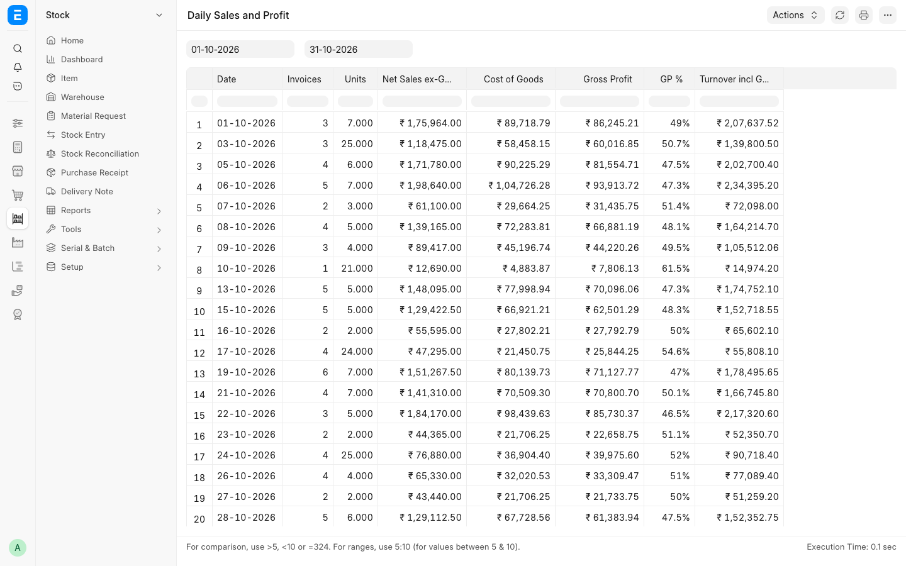 | 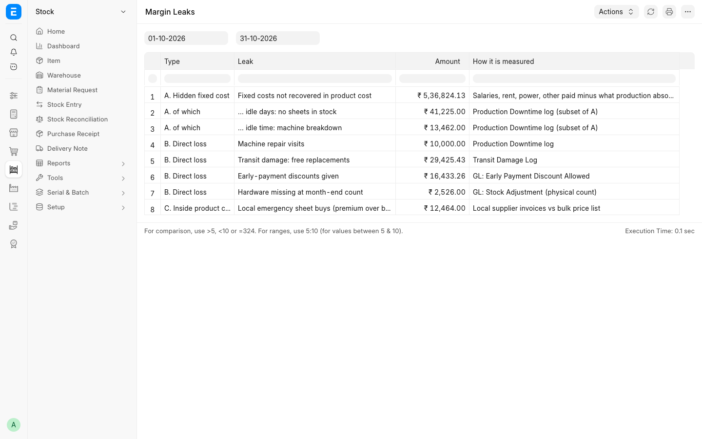 |
| 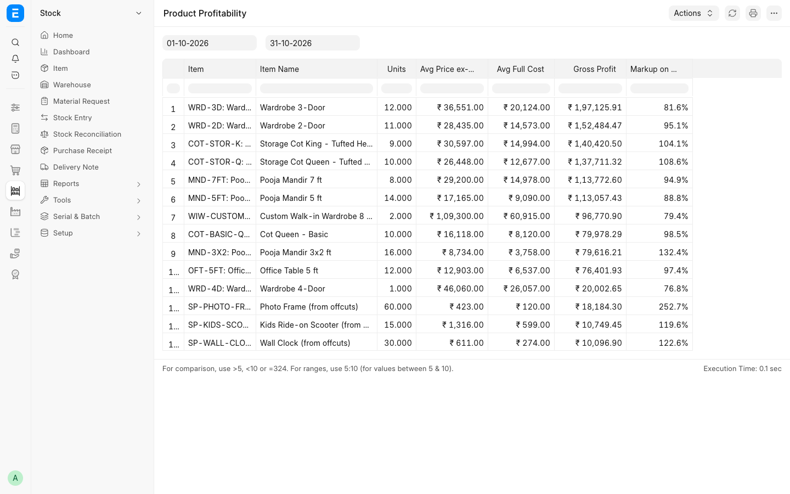 | 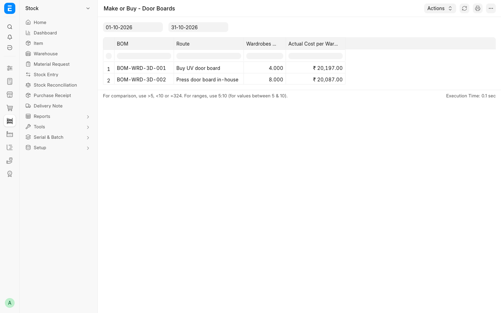 |
| 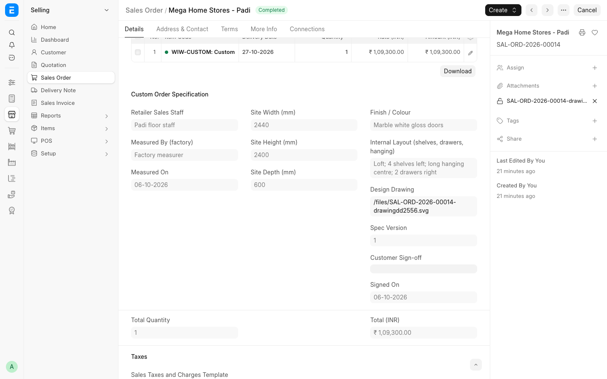 | 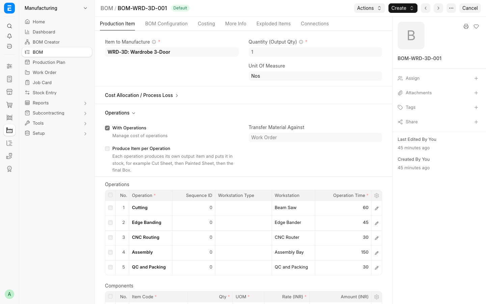 |
| 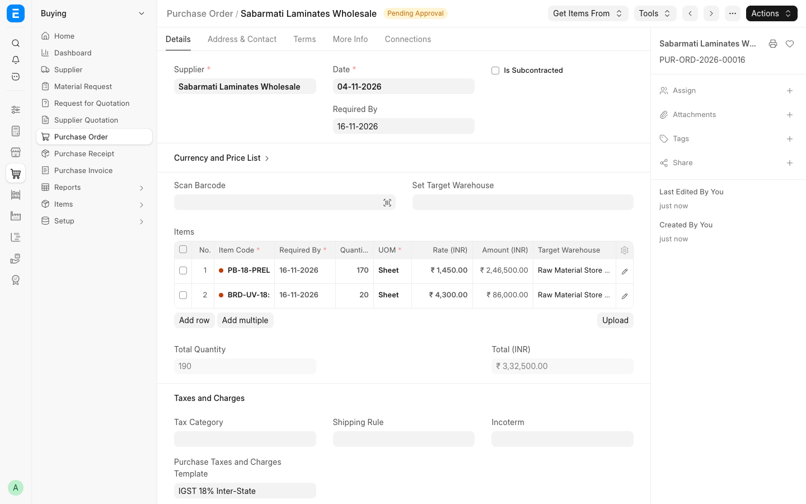 | 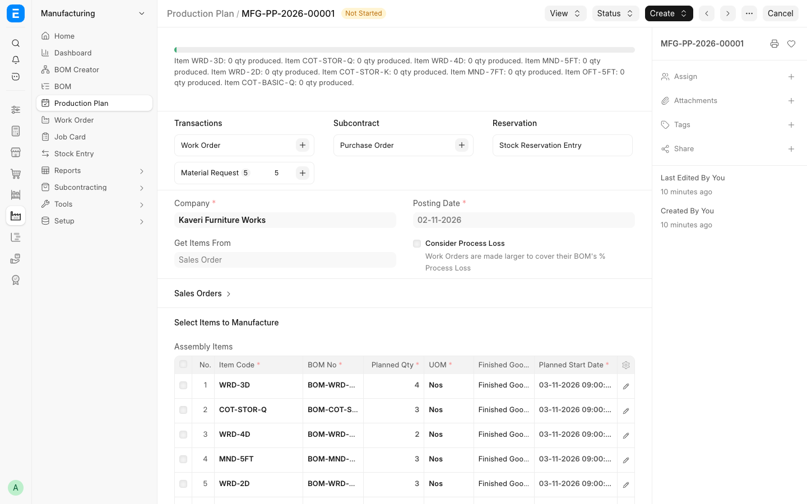 |
| 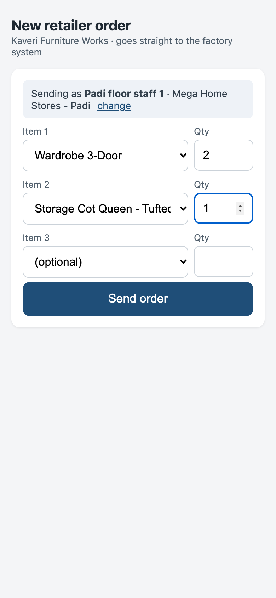 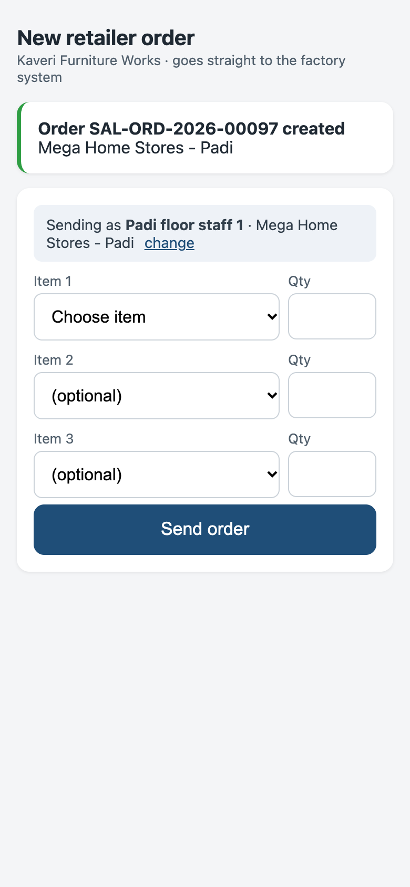 | 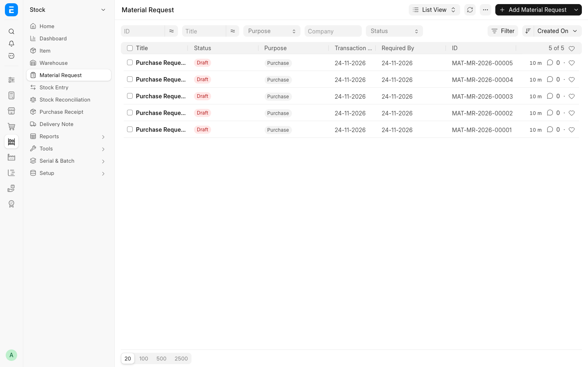 |
