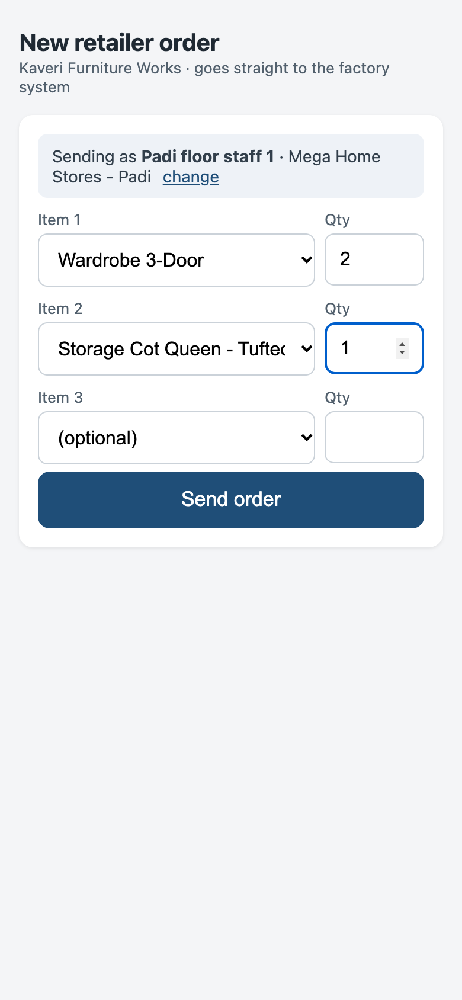

# 9. Integration: retail order intake (REST)

## Why

The factory's 5 sales staff on the largest retailer's floor phone in orders and low-stock alerts. The accountant
then re-types them, and orders get lost or doubled. The intake service lets staff send an order from their phone
straight into ERPNext. Any other system (a retailer's billing software, a WhatsApp bot) can use the same JSON API.



## Design

```
phone form / other system ──POST──► intake service (FastAPI)
                                     1. validate: staff code → retailer; item is a sellable finished good; qty 1–20
                                     2. write to local SQLite outbox  (idempotency key = primary key)
                                     3. try ERPNext now ──REST (token auth, integration user)──► Sales Order, submitted
                                        ├─ ERPNext answered 4xx  → 'rejected' + reason (no retry)
                                        └─ network error / 5xx   → stays 'queued'; worker retries 15 s, 30 s, 60 s … (backoff)
```

| Concern | How it is handled |
|---|---|
| Double tap / resend after timeout | The idempotency key is the outbox primary key. Replays return the existing result |
| Crash after ERPNext saved the order but before the outbox recorded it | Before creating, the service looks up a Sales Order carrying the key in the unique custom field `custom_intake_ref` |
| ERPNext or internet down | Order is saved locally; staff see "Saved, will send automatically"; the background worker delivers it later |
| Two workers sending the same row | A row is claimed with a conditional `UPDATE … WHERE next_try <= now` before sending |
| Security | Per-staff codes map to exactly one retailer; ERPNext access is a dedicated user with the Sales User role only (API key in a git-ignored `.env`) |
| Bad input | Unknown items, quantities outside 1–20 and unknown staff are rejected before ERPNext is called (422 / 401) |

## Who hears about a new order

ERPNext Notification *New Order Confirmed* (`scripts/notifications.py`) fires when the Sales Order is submitted and
puts an alert in the bell of the owner, the accountant and the store supervisor: order number, retailer, value, items,
delivery date, and which floor staff member sent it. Email or WhatsApp can be added to the same notification once an
email account or a WhatsApp Business provider is configured.

## Endpoints

| Method | Path | Purpose |
|---|---|---|
| GET | `/` | Mobile order form |
| POST | `/order` | Form submit |
| POST | `/api/orders` | JSON: `{"idempotency_key", "lines": [{"item_code", "qty"}]}` with header `X-Staff-Token` |
| GET | `/api/orders/{key}` | Status: queued / sent / rejected, ERPNext order number, attempts, last error |

## Tests (`integration/order_intake/test_intake.py`, against the live site): 8/8 pass

1. Order creates a confirmed Sales Order for the staff member's retailer
2. Double tap → one Sales Order
3. Unknown item → 422, ERPNext not called
4. Unknown staff code → 401
5–6. Quantity 0 and 21 → 422
7. ERPNext outage → order queued → retry after recovery → exactly one Sales Order
8. Crash after ERPNext write → replay finds the existing order, no duplicate

## Run

```bash
cd integration/order_intake
../../.venv/bin/python setup_integration.py          # custom field, integration user, API key → .env
../../.venv/bin/uvicorn app:app --port 8090          # then open http://localhost:8090/?token=PADI-01 on a phone
```
